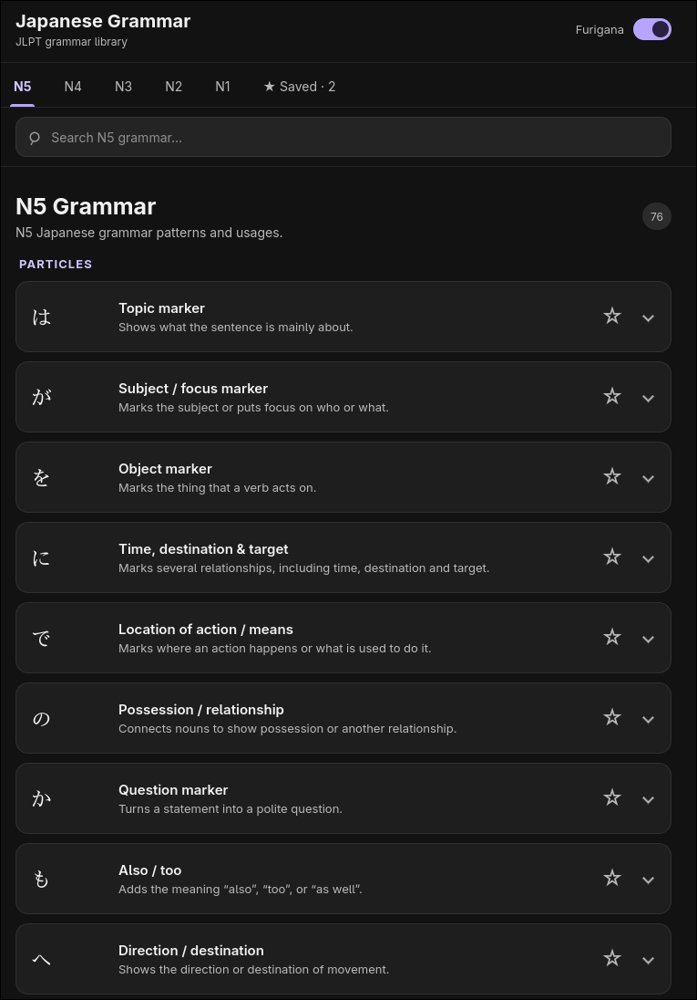

# Nath's 日本語 Tools

A static site with seven ways to study Japanese, from N5 to N1. It runs on
GitHub Pages with no build step and no server.

| App | Folder | What it does |
| --- | --- | --- |
| Grammar | `grammar/` | The JLPT grammar library: every pattern, with examples and quizzes. |
| Grammar course | `grammar-course/` | The library's 485 grammar points, five a lesson, with fill-in-the-blank and sentence-building reviews. |
| Vocabulary | `vocab/` | The 5,111 words of the readings and tracks, each lesson just before its passages. |
| Writing | `writing/` | Kana and 2,195 kanji, written by hand on paper, with stroke order. |
| Conjugation | `conjugation/` | Word types and every form, typed and checked. |
| Reading | `reading/` | 132 graded readings with tappable words and comprehension questions. |
| Listening | `listening/` | 132 voiced tracks with questions and dictation. |

The landing page (`index.html`) links to all seven. Four of the study apps are web
ports of the Android apps in `vibe-jap-writing`, `vibe-srs-jap-conjugating`,
`vibe-jap-reading` and `vibe-jap-listening`. They use the same content, the
same FSRS scheduling and the same course structure, stats and achievements.
Vocabulary is built for this site from the Reading and Listening content (see
Updating content), and the grammar course from the grammar library, both on the
same engine.



## Where progress is kept

Everything stays in the browser, on the device:

- The grammar library keeps saved points and settings in `localStorage`
  (`grammarNotebook.*`). The theme key is shared by the whole site.
- Each study app keeps its progress in its own IndexedDB database
  (`vibe-grammar`, `vibe-vocab`, `vibe-writing`, `vibe-conjugation`,
  `vibe-reading`, `vibe-listening`). The
  tables mirror the Android apps' SQLite schema. IndexedDB is used instead of
  `localStorage` because the answer history quickly outgrows `localStorage`'s
  5 MB limit.

The landing page reads every app's database to show a combined streak, cards
due, today's answers, this week's study time and a 14-day chart. Course
progress on each tile comes from a small summary each app saves in
`localStorage` (`vibe.summary.<app>`) whenever it's opened or a quiz ends,
because the landing page doesn't load the course content.

Each app's Settings tab can back up and restore that app. The landing page can
back up and restore everything at once.

### What you know, across the apps

`shared/learner.js` keeps one shared record of what you know, in its own
database (`vibe-learner`). It's an index built from the apps, not a copy of
their progress: each app keeps its own database and review schedule as before.

- **Items** are things you can know, with the same id in every app: words by
  headword and reading (`w:食べる|たべる`), kanji (`k:食`), kana (`kana:た`),
  conjugation forms (`f:te`) and grammar points by their library id
  (`g:n4-nagara`).
- **Links** tie an item to an app's evidence for it. Cards and sections say what
  they teach in a `learn` list: a card in the review deck means you're
  studying the item, and a passed section means you've met it. A word is
  *known* once one of its cards is expected to stick for three weeks.
- Each app sends all its links when it opens and after every change, so the
  record can't drift from the app's data, even after a restore or reset.
  Word lookups in Reading and Listening are the only data kept just here, so
  whole-site backups include this database.

Lessons in Vocabulary, Writing and Conjugation let you mark an item as already
known (`knownToggle` in `shared/srs/screens.js`). Its cards skip the lesson quiz
and join the reviews as known, with the first check in a month
(`SrsModel.markKnown`); the mark is kept on the card's row (`marked_known`)
until that first review, and can be undone until then. A part whose items are
all marked can be finished without a quiz.

The landing page shows the counts under "What you know", and the word popup in
Reading and Listening says when you're already learning a word elsewhere. Rows
record when they last changed, ready for syncing between devices later.

### Grammar across the apps

The grammar course (`grammar-course/`) teaches the library's points in library
order, five a lesson within each level. Each point has two cards: a
fill-in-the-blank from one of its own examples, with options from related
points, and sentence building, where one of its examples is split into pieces to
tap back into order from the English. The pieces come from a simple rule in
`grammar-core.js` (`sentencePieces`): a new piece starts where kanji or
katakana follows a particle or word ending, or after 、 and 。, never inside a
kanji reading or the grammar point itself. Examples that give fewer than three
pieces are skipped, which leaves 55 of the 485 points with only the first card.
An answer is right when the pieces rebuild the sentence exactly.
It uses the library's own logic for that: `grammar/grammar-core.js` holds the
data access, highlighting, furigana and question-building that both pages load.
The library opens an entry from a link like `grammar/index.html#n4-nagara`, and
each entry shows where it stands in the course. `shared/grammar-links.js` maps
Conjugation lessons and the form labels in Reading and Listening to grammar
points, so Conjugation lessons and the word popup link into the library; the
tests check every id and pattern there against the library's data.

## Layout

```
index.html, landing.*      the landing page
shared/core.css            the shared look (light and dark)
shared/learner.js          what you know across the apps (see above)
shared/grammar-links.js    grammar points behind Conjugation lessons and passage forms
shared/staging.js          keeps the staging site's data separate (see Staging)
shared/srs/                the shared study-app engine
  fsrs.js                    FSRS scheduler, ported from the Dart fsrs 2.0.1 package
  store.js                   IndexedDB tables, held in memory while an app is open
  model.js                   progress, unlocking, decks, reviews, backups, achievements
  quiz-engine.js             rounds that repeat missed cards, and resuming
  stats.js, focus.js         stats, recommended focus and insights
  screens.js, ui.js          the shared screens and the hash router
  passage.js                 tappable Japanese text with furigana and read-aloud
  romaji.js                  romaji to kana, for keyboards without Japanese input
grammar-course/, vocab/, writing/, conjugation/, reading/, listening/
  app.js                     each app's content loader, model and screens
  data/                      content copied from the Android repos
grammar/                   the grammar library
  grammar-core.js            its data, highlighting and question-building, shared with the course
tools/sync-content.sh      copies content from the Android repos
tools/build-vocab.py       builds the vocabulary course from Reading and Listening
```

## Updating content

Rebuild content in the Android app repos as their READMEs describe, then copy
it across:

```
tools/sync-content.sh [FOLDER_HOLDING_THE_REPOS]
```

The sync then rebuilds the vocabulary course (`vocab/data/content.json`) with
`tools/build-vocab.py`. Lesson n holds the words that first appear in Reading n
or Track n, in the order they come up, leaving pure grammar words (particles,
the copula) to the grammar library. Each word keeps an example sentence from
its lesson's passages, with the track's audio timing when it comes from
Listening. To rebuild it on its own: `python3 tools/build-vocab.py`.

`conjugation/data/examples.json` is written for this site, not copied, so a
sync leaves it alone. It holds the example sentences shown under each lesson's
table, keyed by section id. Each sentence names a word and form, with `{}`
where the word goes in that form and furigana written as `漢字[かんじ]`. The
tests check every sentence still fits the synced content.

The folder defaults to this repo's parent.

## Tests

Browser tests drive a real headless Chrome through each app the way a learner
would: lessons, typed and romaji answers, typo fixes, reviews, resuming a quiz,
audio and dictation, backups, the landing page's stats and backup reminder, and
Android phone emulation with touch. Any JavaScript error fails the test.

```
python3 tools/tests/run.py            # everything, about 3 minutes
python3 tools/tests/run.py listening  # just the tests with "listening" in their name
```

They need only Python 3 and Chrome or Chromium (set `CHROME` to its path if it
isn't found). Each test starts its own web server and a fresh browser profile.
Run them after `tools/sync-content.sh` too: the apps reimplement the Android
apps' logic, so a change to a content format shows up here first.

## Running locally

The apps load their content with `fetch` and use ES modules, so open them
through a web server, not from the file system:

```
python3 -m http.server 8000
```

Then open http://localhost:8000.

## Staging

Changes are tested on a copy of the site before they go live. The copy is a
second repo, `japanese-grammar-staging`, with GitHub Pages turned on:

```
git push -f staging some-branch:main
```

Then open https://nathankewley.github.io/japanese-grammar-staging/.

Both sites are on `nathankewley.github.io`, and browsers keep saved data per
site, so they would normally share progress. `shared/staging.js`, loaded first
on every page, prevents that: on any copy whose first folder ends in
`-staging`, it quietly adds a `staging.` prefix to every saved setting and
database. Staging starts empty and can't touch real progress, and an orange
STAGING tab on the left edge shows which site you're on. The code still sees the
usual names, so backups work in both directions: restore a real backup on
staging to test with a copy of your progress. On the real site the script does
nothing.

## Notes

- **iPhone and iPad:** Safari clears a website's stored data after 7 days without
  a visit, but not for sites added to the Home Screen. The site has a web app
  manifest and icons, so *Share → Add to Home Screen* installs it. The Home
  Screen copy keeps its own storage, separate from Safari's.
- **Android:** Chrome keeps the data unless it's cleared or the phone runs very
  low on space. Chrome can install the site as an app (the manifest has
  maskable icons for Android's launcher shapes), and the browser bar follows
  the site's light or dark theme.
- **Read-aloud** in Reading uses the browser's Japanese text-to-speech voice,
  which some devices need installed first.
- **Listening audio** is Ogg Opus, with an AAC (`.m4a`) copy of each track for
  browsers that can't play Ogg, such as Safari on iPhone. The app picks the
  format the browser supports. `tools/sync-content.sh` makes the copies with
  ffmpeg.
- **Typed answers** accept kana, kanji or romaji. Romaji is converted to kana, and
  the conversion is shown as you type.
- **Debugging:** each study app exposes itself as `window.vibeApp` in the
  browser console.

## Data sources and licences

The content files in `*/data/` are derived from these sources and are shared
under the same terms (CC BY-SA). Each app's Settings tab carries the credits.

- Word meanings: [JMdict](https://www.edrdg.org/wiki/index.php/JMdict-EDICT_Dictionary_Project), EDRDG, CC BY-SA 4.0.
- Kanji: [KANJIDIC2](https://www.edrdg.org/wiki/index.php/KANJIDIC_Project), EDRDG, CC BY-SA 4.0.
- Stroke order: [KanjiVG](https://kanjivg.tagaini.net/) by Ulrich Apel, CC BY-SA 3.0.
- Literature in Reading: public-domain works from [Aozora Bunko](https://www.aozora.gr.jp/).
- Voices in Listening: [VOICEVOX](https://voicevox.hiroshiba.jp/). The Listening app's Settings tab lists each voice.
